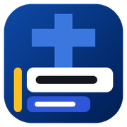
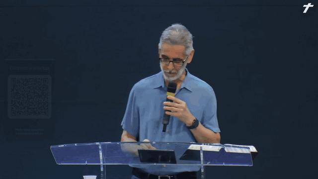
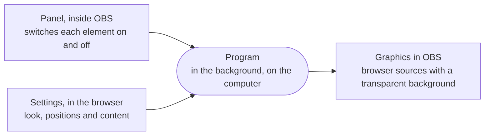
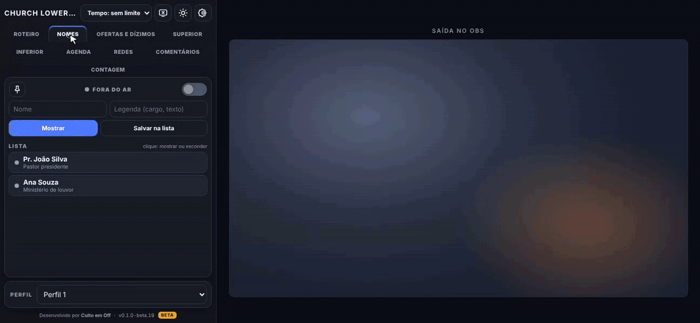
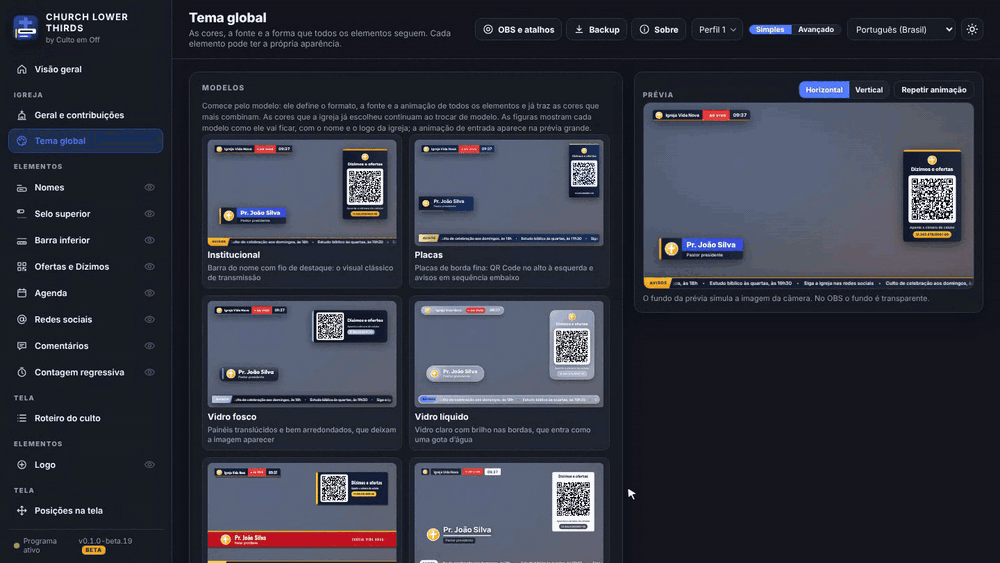
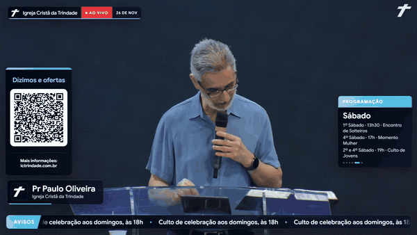
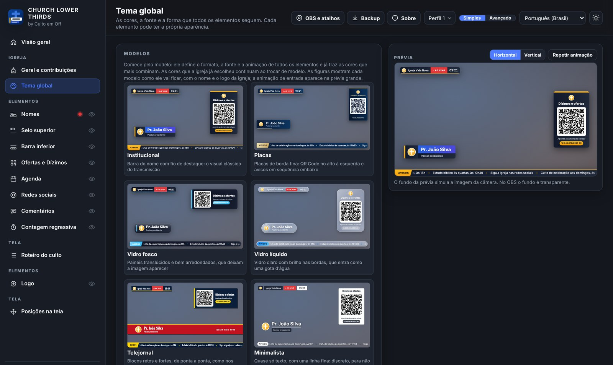

# Church Lower Thirds — by Culto em Off

**Free lower thirds & overlays for church live streams in OBS Studio — Windows and macOS.**

[Português](README.md) · [English](README.en.md)

Names, a corner badge, a ticker, tithes and offerings with a QR code, the week's schedule, social handles, comments and a countdown, with ready-made styles and a control panel docked inside OBS itself. Free.

### [⬇️ Download for Windows and macOS](https://github.com/CultoemOff/Church-Lower-Thirds-Releases/releases/latest)

_On a real stream: the badge, the notices, the giving card, the name and the schedule come in over the camera, each with its own animation._

## What goes on screen

Nine elements. Each one is switched on and off by itself, and all of them follow the same theme.

| Element            | What it shows                                                                            |
| ------------------ | ---------------------------------------------------------------------------------------- |
| Names              | Name and caption of the preacher, singer or guest, typed live or saved in a list         |
| Tithes & offerings | A card with a QR code for a payment app, a link or bank details; several saved offerings |
| Corner badge       | Logo, church name, "live", time, date and short messages, in a corner                    |
| Ticker             | Notices in scrolling text                                                                |
| Schedule           | Days and times of the services, one day at a time                                        |
| Social             | "Follow us" with each network's handle, one at a time or in sequence                     |
| Comments           | A comment typed live, with the name of who wrote it                                      |
| Countdown          | The time left until the service starts                                                   |
| Logo               | The church logo fixed in a corner                                                        |

Giving is not tied to one country: PIX (Brazil), payment apps by phone number or code, SEPA transfer (EPC QR), a link, an uploaded QR image or plain bank details. Each language starts from what its main country uses.

## How it works

Church Lower Thirds has four parts, all running on the streaming computer itself:

- **The program** runs in the background and starts with the computer. It keeps the settings and knows what should be on air.
- **The graphics** enter OBS as browser sources with a transparent background, over the camera. There is one source with every element and one per element, for those who prefer to split them by scene.
- **The panel** is a dock inside OBS. It is where the operator switches each element on and off during the service.
- **The settings** open in the browser, with a live preview. It is where the look and the content are prepared before the service.

## Download and install

Always get the latest version from:

**https://github.com/CultoemOff/Church-Lower-Thirds-Releases/releases/latest**

| File                                      | What for                                                    |
| ----------------------------------------- | ----------------------------------------------------------- |
| `Church-Lower-Thirds-Setup-<version>.exe` | Installer for Windows 10 and 11 (64-bit)                    |
| `Church-Lower-Thirds-macOS-<version>.pkg` | Installer for macOS 13.5 or later (Apple Silicon and Intel) |
| `SHA256SUMS.txt`                          | SHA-256 hashes of both installers, to check the download    |

The only other requirement is **OBS Studio**.

### Windows

1. Download the `.exe` file and run it.
2. If Windows shows the SmartScreen warning, click **More info** and then **Run anyway**. The warning appears because the installer has no digital signature yet.
3. Accept the license and choose the folder for your files (settings, images and the OBS source files). The suggestion is `Documents\Church Lower Thirds`.
4. When it finishes, the settings open in the browser with an illustrated assistant for the first steps.

### macOS

1. Download the `.pkg` file and double-click it.
2. macOS says it could not verify the developer, because the package is not signed by Apple yet. To allow it:
   - **macOS 15 or later:** close the warning, open **System Settings › Privacy & Security**, scroll down to the notice about Church Lower Thirds and click **Open Anyway**.
   - **macOS 13 and 14:** right-click (or Control-click) the file, choose **Open** and confirm with **Open**.
3. Follow the installer: it shows the license and asks for the Mac's password.
4. When it finishes, the settings open in the browser with the same assistant. The program lives in **Applications** and starts by itself when you log in.

## Connecting to OBS Studio

1. In the settings, open **OBS and shortcuts**. With the OBS WebSocket server enabled (**Tools › WebSocket Server Settings**), the program **creates the browser sources in OBS with one click**.
2. Prefer to do it by hand? In **Sources › + › Browser**, check **Local file** and choose one of the files in the `OBS Sources` folder (width 1920, height 1080). `All Elements` brings everything in a single source; the others bring one element each.
3. Add the panel with **Docks › Custom Browser Docks…** and the address `http://127.0.0.1:8795/dock`, then dock it where you like.

The `… (Vertical).html` files are for vertical streams (1080 × 1920).

## The panel inside OBS

During the service the operator only uses the panel, without leaving OBS.

- **One tab per element.** The red dot on a tab shows what is on air.
- **On/off switch.** Grey is off air; red is on air. The element comes in and goes out with the animation of the style.
- **Ready list.** One click on a saved name puts that name on screen. A name can also be typed on the spot.
- **Groups of names.** Saved names can be kept in groups (Pastors, Worship, Guests…) that fold. The search looks in every group at once.
- **Offerings with a miniature.** The offerings tab shows the card as it goes on air: the QR code, the texts and the colors. The card stays on screen until it is switched off.
- **Time on screen.** A global time takes names, social networks and comments off by themselves, and the pin keeps what should stay.
- **Order of service.** Puts what goes on air in order and moves on with one click on "Next". Those who do not use it can hide the tab.
- **Profile.** Changes everything at once, for example from the Sunday service to the women's meeting.

_On the left, the panel; on the right, what goes on air. (The interface is shown in Portuguese; it is also available in English, Spanish, Italian and German.)_

## The settings: look and content

The settings open in the browser (`http://127.0.0.1:8795/settings`, or through the program's shortcut) and show everything you change in a live preview.

- **Global theme.** One style, one set of colors and one font apply to every element. Each element can have a look of its own.
- **Positions on screen.** Drag each element into place and pull its corner to resize it, in the horizontal or the vertical layout.
- **Content.** Names, offerings, notices, schedule and social handles are saved and ready for the panel.
- **Simple or advanced mode.** Simple shows only the essentials; advanced opens every option.
- **Backup.** Every setting in one file, to keep or take to another computer.

## Styles and themes

25 ready-made styles and 30 color sets. Changing style changes the shape, the font and the animation of every element at once, and the colors the church chose are kept.

- **Themed styles** for youth, kids, women, couples, choir, band, Christmas and Easter.
- **Liquid glass**: the glass effect applied to any style.
- **Custom styles**: the program hands you a prompt for any AI to write the look of a new style.
- **19 bundled fonts**, besides the ones installed on the computer, and 11 in and out animations.

## Other features

| Feature                 | What it does                                                                                       |
| ----------------------- | -------------------------------------------------------------------------------------------------- |
| Profiles                | Keep separate sets (church name, logo, look, names, offerings and texts) for each service or event |
| Name list               | Pasted in or imported from a CSV file, with search in the panel                                    |
| Vertical layout         | Sources of their own at 1080 × 1920 for vertical streams                                           |
| Stream Deck & Companion | HTTP addresses to show and hide the elements, no plugin needed                                     |
| Sharing                 | Custom styles and profiles travel in a file from one church to another                             |
| Updates                 | The program tells you when there is a new version and updates with one click                       |
| Languages               | Portuguese (Brazil and Portugal), English, Spanish, Italian and German                             |

## Where your files are

| System  | Default folder                  | What is in it                                                     |
| ------- | ------------------------------- | ----------------------------------------------------------------- |
| Windows | `Documents\Church Lower Thirds` | `Data` (settings, names, images) and `OBS Sources` (source files) |
| macOS   | `Movies/Church Lower Thirds`    | The same                                                          |

Copy the whole folder to back everything up. Each user of the computer has their own folder and their own settings.

## Updating and uninstalling

- **Update:** when there is a new version, the settings show **Update now**. The program downloads the installer, checks its SHA-256 and installs it; your settings are kept.
- **Uninstall on Windows:** in **Settings › Apps › Installed apps**, remove Church Lower Thirds.
- **Uninstall on macOS:** in Terminal, run `sudo "/Applications/Church Lower Thirds.app/Contents/Resources/uninstall.sh"`.

On both systems the folder with your files stays where it is; delete it by hand to start from scratch.

## FAQ

**Is it free?**
Yes. It may be downloaded and used freely, in commercial work too.

**Does it need the internet?**
Not to work: everything runs on the computer itself. The internet is only used to look for updates.

**Does it work outside OBS Studio?**
The program was built and tested for OBS Studio. The graphics are local pages (`http://127.0.0.1:8795/source/all`, for example), so they open in any browser; the dockable panel is an OBS feature.

**The panel is blank in OBS. What now?**
Open the program's shortcut: if the settings open in the browser, the program is running and you only need to check the panel's address. If another program is using port 8795, Church Lower Thirds takes the next free one; the right address is shown in **OBS and shortcuts**.

**I updated and OBS still shows the old version.**
In the properties of the browser source, click **Refresh cache of current page**.

## License

Church Lower Thirds is **free and closed-source**: it may be downloaded, installed and used freely, but the code may not be modified, decompiled or sold. The full text is in [LICENSE.txt](LICENSE.txt). The fonts and third-party components that ship with the program follow their own licenses, listed in the program itself under **About › Third-party components**.

The trademarks mentioned belong to their owners. This program is not affiliated with the OBS Project.

## Culto em Off

Created by Jonas Silva, of [Culto em Off](https://www.cultoemoff.com.br): knowledge, tools and solutions for audio, video and live streaming in churches.

[Website](https://www.cultoemoff.com.br) · [YouTube](https://www.youtube.com/@CultoemOff) · [Instagram](https://www.instagram.com/cultoemoff/) · [PTZ Control Web](https://github.com/CultoemOff/PTZ-Control-Web-Releases)
