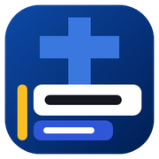
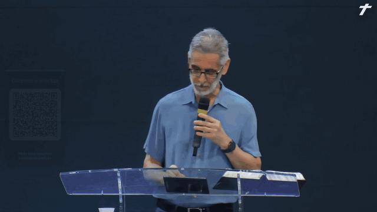
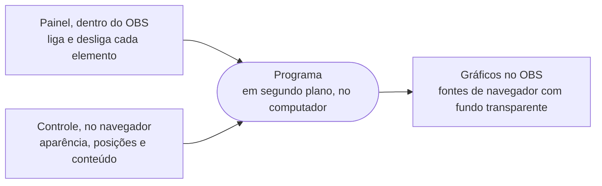
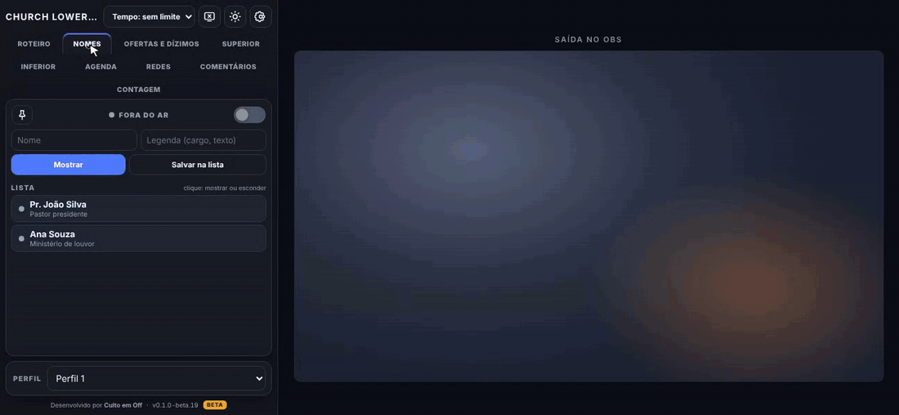
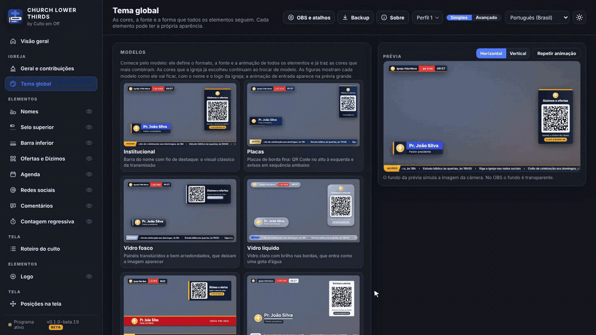
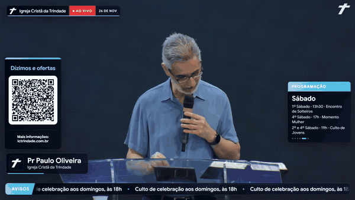
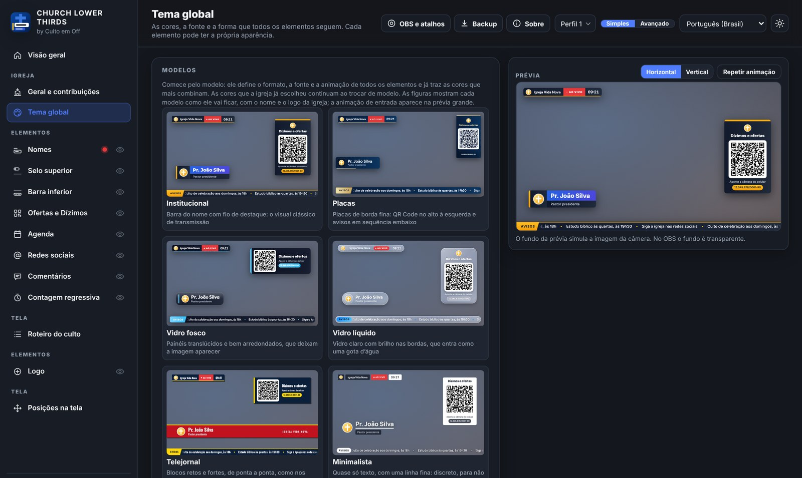

# Church Lower Thirds — by Culto em Off

**Free lower thirds & overlays for church live streams in OBS Studio — Windows and macOS.**

[Português](README.md) · [English](README.en.md)

Lower thirds e overlays para transmissões de igrejas no OBS Studio: nomes, selo de canto, barra de avisos, ofertas e dízimos com QR Code, agenda, redes sociais, comentários e contagem regressiva, com modelos prontos e controle por um painel dentro do próprio OBS. Gratuito.

### [⬇️ Baixar para Windows e macOS](https://github.com/CultoemOff/Church-Lower-Thirds-Releases/releases/latest)

_Numa transmissão real: o selo, os avisos, as ofertas, o nome e a agenda entram por cima da câmera, cada um com a sua animação._

## Índice

- [O que vai para a tela](#o-que-vai-para-a-tela)
- [Como funciona](#como-funciona)
- [Download e instalação](#download-e-instalação)
- [Como ligar ao OBS Studio](#como-ligar-ao-obs-studio)
- [O painel dentro do OBS](#o-painel-dentro-do-obs)
- [O controle: aparência e conteúdo](#o-controle-aparência-e-conteúdo)
- [Modelos e temas](#modelos-e-temas)
- [Outros recursos](#outros-recursos)
- [Onde ficam os seus arquivos](#onde-ficam-os-seus-arquivos)
- [Atualização e desinstalação](#atualização-e-desinstalação)
- [Perguntas frequentes](#perguntas-frequentes)
- [Licença](#licença)

## O que vai para a tela

São nove elementos. Cada um liga e desliga sozinho, e todos seguem o mesmo tema.

| Elemento            | O que mostra                                                                            |
| ------------------- | --------------------------------------------------------------------------------------- |
| Nomes               | Nome e legenda do pregador, cantor ou convidado, digitados na hora ou salvos numa lista |
| Ofertas e dízimos   | Cartão com QR Code de PIX, de link ou com os dados bancários; várias ofertas salvas     |
| Selo superior       | Logo, nome da igreja, "ao vivo", hora, data e recados, num canto da tela                |
| Barra inferior      | Avisos em texto rolando                                                                 |
| Agenda              | Dias e horários dos cultos, um dia por vez                                              |
| Redes sociais       | "Siga-nos" com o @ de cada rede, uma por vez ou em sequência                            |
| Comentários         | Um comentário digitado na hora, com o nome de quem escreveu                             |
| Contagem regressiva | O tempo que falta para o culto começar                                                  |
| Logo                | O logo da igreja fixo num canto                                                         |

_Os elementos no modelo Institucional. No OBS o fundo é transparente._

A contribuição não é só PIX: também há aplicativo de pagamento por telefone ou código, transferência SEPA (QR EPC), link, imagem de QR Code enviada ou só os dados bancários. Cada idioma começa pelo que o seu país usa.

## Como funciona

O Church Lower Thirds tem quatro peças, e todas rodam no próprio computador da transmissão:

- **O programa** fica em segundo plano e inicia com o computador. Ele guarda as configurações e sabe o que deve estar no ar.
- **Os gráficos** entram no OBS como fontes de navegador com fundo transparente, por cima da câmera. Há uma fonte com todos os elementos e uma para cada elemento, para quem prefere separar por cena.
- **O painel** é um dock dentro do OBS. É ali que o operador liga e desliga cada elemento durante o culto.
- **O controle** abre no navegador, com prévia ao vivo. É onde se preparam a aparência e o conteúdo antes do culto.

O painel e o controle só mandam pedidos; quem atualiza os gráficos é o programa. Por isso o que se muda aparece na hora, sem recarregar as fontes no OBS.

## Download e instalação

Baixe sempre a versão mais recente em:

**https://github.com/CultoemOff/Church-Lower-Thirds-Releases/releases/latest**

Em **Assets** ficam três arquivos:

| Arquivo                                  | Para quê                                                        |
| ---------------------------------------- | --------------------------------------------------------------- |
| `Church-Lower-Thirds-Setup-<versão>.exe` | Instalador para Windows 10 e 11 (64 bits)                       |
| `Church-Lower-Thirds-macOS-<versão>.pkg` | Instalador para macOS 13.5 ou mais novo (Apple Silicon e Intel) |
| `SHA256SUMS.txt`                         | Hash SHA-256 dos dois instaladores, para conferir o download    |

O único outro requisito é o **OBS Studio**.

### Windows

1. Baixe o arquivo `.exe` e execute.
2. Se o Windows mostrar o aviso do SmartScreen, clique em **Mais informações** e depois em **Executar assim mesmo**. O aviso aparece porque o instalador ainda não tem assinatura digital.
3. Aceite a licença e escolha a pasta dos seus arquivos (configurações, imagens e os arquivos das fontes do OBS). O sugerido é `Documentos\Church Lower Thirds`.
4. Ao terminar, as configurações abrem no navegador com um assistente ilustrado para os primeiros passos.

### macOS

1. Baixe o arquivo `.pkg` e abra com dois cliques.
2. O macOS avisa que não conseguiu verificar o desenvolvedor, porque o pacote ainda não é assinado pela Apple. Para liberar:
   - **macOS 15 ou mais novo:** feche o aviso, abra **Ajustes do Sistema › Privacidade e Segurança**, desça até o aviso sobre o Church Lower Thirds e clique em **Abrir Mesmo Assim**.
   - **macOS 13 e 14:** clique no arquivo com o botão direito (ou Control + clique), escolha **Abrir** e confirme em **Abrir**.
3. Siga o instalador: ele mostra a licença e pede a senha do Mac.
4. Ao terminar, as configurações abrem no navegador com o mesmo assistente. O programa fica na pasta **Aplicativos** e passa a iniciar sozinho quando você entra no Mac.

## Como ligar ao OBS Studio

1. No controle, abra **OBS e atalhos**. Com o WebSocket do OBS ligado (**Ferramentas › Configurações do servidor WebSocket**), o programa **cria as fontes de navegador no OBS com um clique**.
2. Prefere fazer à mão? Em **Fontes › + › Navegador**, marque **Arquivo local** e escolha um dos arquivos da pasta `OBS Sources` (largura 1920, altura 1080). `All Elements` traz tudo numa fonte só; os outros trazem um elemento cada.
3. Adicione o painel em **Painéis › Painéis personalizáveis com URL…** com o endereço `http://127.0.0.1:8795/dock` e encaixe onde preferir.

| Arquivo             | Elemento            |
| ------------------- | ------------------- |
| `All Elements.html` | todos               |
| `Names.html`        | nomes (lower third) |
| `Corner Badge.html` | selo superior       |
| `Ticker.html`       | barra inferior      |
| `QR Card.html`      | ofertas e dízimos   |
| `Schedule.html`     | agenda              |
| `Social.html`       | redes sociais       |
| `Logo.html`         | logo                |

Os arquivos `… (Vertical).html` são para transmissões na vertical (1080 × 1920).

## O painel dentro do OBS

Durante o culto, o operador só usa o painel, sem sair do OBS.

- **Uma aba por elemento.** O ponto vermelho na aba mostra o que está no ar.
- **Chave liga/desliga.** Cinza é fora do ar; vermelha é no ar. O elemento entra e sai com a animação do modelo.
- **Lista pronta.** Um clique num nome salvo coloca esse nome na tela. Também dá para digitar um nome na hora.
- **Grupos de nomes.** Os nomes salvos podem ficar em grupos (Pastores, Louvor, Convidados…), que se minimizam. A busca procura em todos os grupos de uma vez.
- **Ofertas com miniatura.** A aba de ofertas mostra o cartão como ele vai ao ar: o QR Code, os textos e as cores. O cartão fica na tela até ser desligado.
- **Tempo na tela.** Um tempo global tira nomes, redes e comentários sozinhos, e o alfinete fixa o que deve ficar.
- **Roteiro do culto.** Põe em ordem o que vai ao ar e avança com um clique em "Próximo". Quem não usa pode esconder a aba.
- **Perfil.** Troca tudo de uma vez, por exemplo do culto de domingo para o encontro de mulheres.

_À esquerda, o painel; à direita, o que vai ao ar. Cada clique aparece na hora._

## O controle: aparência e conteúdo

O controle abre no navegador (`http://127.0.0.1:8795/settings`, ou pelo atalho do programa) e mostra, numa prévia ao vivo, tudo o que se muda.

- **Tema global.** Um modelo, um conjunto de cores e uma fonte valem para todos os elementos. Cada elemento pode ter aparência própria.
- **Posições na tela.** Arraste cada elemento para o lugar e puxe o canto para mudar o tamanho, no layout horizontal ou no vertical.
- **Conteúdo.** Nomes, ofertas, avisos, agenda e redes ficam salvos e prontos para o painel.
- **Modo simples ou avançado.** O simples mostra só o essencial; o avançado abre todos os ajustes.
- **Backup.** Todas as configurações num arquivo, para guardar ou levar a outro computador.

_No controle: a troca de modelo com prévia ao vivo e o nome arrastado para outro lugar da tela._

## Modelos e temas

São 25 modelos prontos e 30 conjuntos de cores. Trocar de modelo muda o formato, a fonte e a animação de todos os elementos de uma vez, e as cores que a igreja escolheu continuam.

- **Modelos temáticos** para jovens, kids, mulheres, casais, coral, banda, Natal e Páscoa.
- **Vidro líquido**: o efeito de vidro aplicado a qualquer modelo.
- **Modelos próprios**: o programa entrega um prompt para qualquer IA escrever a aparência de um modelo novo.
- **19 fontes incluídas**, além das instaladas no computador, e 11 animações de entrada e saída.

_A mesma transmissão em três temas: a troca vale para todos os elementos de uma vez._

_Os modelos aparecem como vão ficar, já com o nome e o logo da igreja._

## Outros recursos

| Recurso                 | O que faz                                                                                                        |
| ----------------------- | ---------------------------------------------------------------------------------------------------------------- |
| Perfis                  | Guardam conjuntos separados (nome da igreja, logo, aparência, nomes, ofertas e textos) para cada culto ou evento |
| Lista de nomes          | Entra colada ou por arquivo CSV, com busca no painel                                                             |
| Layout vertical         | Fontes próprias em 1080 × 1920 para transmissões na vertical                                                     |
| Stream Deck e Companion | Endereços HTTP para mostrar e esconder os elementos, sem plugin                                                  |
| Compartilhamento        | Modelos próprios e perfis viajam em arquivo de uma igreja a outra                                                |
| Atualização             | O programa avisa quando há versão nova e atualiza com um clique                                                  |
| Idiomas                 | Português (Brasil e Portugal), inglês, espanhol, italiano e alemão                                               |

## Onde ficam os seus arquivos

| Sistema | Pasta padrão                     | O que há nela                                                                |
| ------- | -------------------------------- | ---------------------------------------------------------------------------- |
| Windows | `Documentos\Church Lower Thirds` | `Data` (configurações, nomes, imagens) e `OBS Sources` (arquivos das fontes) |
| macOS   | `Filmes/Church Lower Thirds`     | O mesmo                                                                      |

Copie a pasta inteira para ter um backup de tudo. Cada usuário do computador tem a sua própria pasta e as suas próprias configurações.

## Atualização e desinstalação

- **Atualizar:** quando há versão nova, o controle mostra **Atualizar agora**. O programa baixa o instalador, confere o SHA-256 e instala; as configurações são mantidas.
- **Desinstalar no Windows:** em **Configurações › Aplicativos › Aplicativos instalados**, remova o Church Lower Thirds.
- **Desinstalar no macOS:** no Terminal, rode `sudo "/Applications/Church Lower Thirds.app/Contents/Resources/uninstall.sh"`.

Nos dois sistemas, a pasta dos seus arquivos fica onde está; apague-a à mão se quiser começar do zero.

## Perguntas frequentes

**É gratuito?**
Sim. Pode ser baixado e usado à vontade, também em trabalhos comerciais.

**Precisa de internet?**
Não para funcionar: tudo roda no próprio computador. A internet só é usada para procurar atualizações.

**Funciona fora do OBS Studio?**
O programa foi feito e testado para o OBS Studio. Os gráficos são páginas locais (`http://127.0.0.1:8795/source/all`, por exemplo), então abrem em qualquer navegador; o painel encaixável é um recurso do OBS.

**O painel aparece em branco no OBS. O que fazer?**
Abra o atalho do programa: se as configurações abrirem no navegador, o programa está rodando e basta conferir o endereço do painel. Se outro programa ocupa a porta 8795, o Church Lower Thirds usa a próxima livre; o endereço certo aparece em **OBS e atalhos**.

**Atualizei e o OBS ainda mostra a versão antiga.**
Nas propriedades da fonte de navegador, clique em **Atualizar cache da página atual**.

**O Windows ou o macOS avisam que o instalador é de origem desconhecida.**
Os instaladores ainda não têm assinatura digital. Baixe só pelo endereço oficial acima e, se quiser, confira o arquivo com o `SHA256SUMS.txt`.

## Licença

O Church Lower Thirds é **gratuito e de código fechado**: pode ser baixado, instalado e usado à vontade, mas o código não pode ser modificado, descompilado nem vendido. O texto completo está em [LICENSE.txt](LICENSE.txt). As fontes e os componentes de terceiros que acompanham o programa seguem as licenças deles, listadas no próprio programa em **Sobre › Componentes de terceiros**.

As marcas citadas pertencem aos seus donos. Este programa não é afiliado ao OBS Project.

## Culto em Off

Projeto criado por Jonas Silva, do [Culto em Off](https://www.cultoemoff.com.br): conhecimento, ferramentas e soluções para áudio, vídeo e transmissão em igrejas.

[Site](https://www.cultoemoff.com.br) · [Curso de OBS Studio](https://cultoemoff.com.br/formacoes/culto-ao-vivo-com-excelencia) · [YouTube](https://www.youtube.com/@CultoemOff) · [Instagram](https://www.instagram.com/cultoemoff/) · [PTZ Control Web](https://github.com/CultoemOff/PTZ-Control-Web-Releases)
